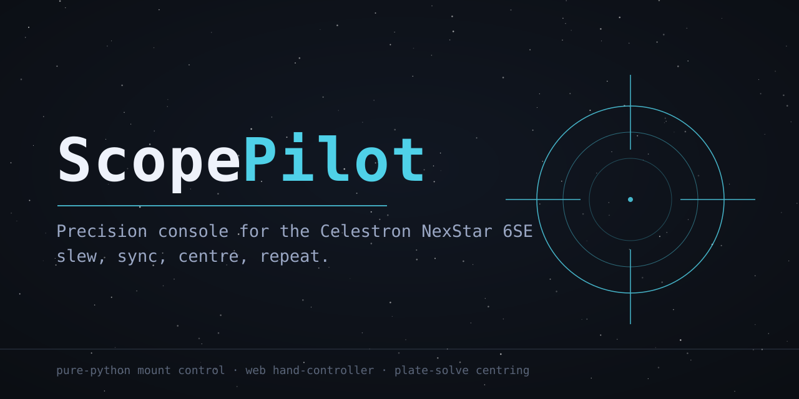
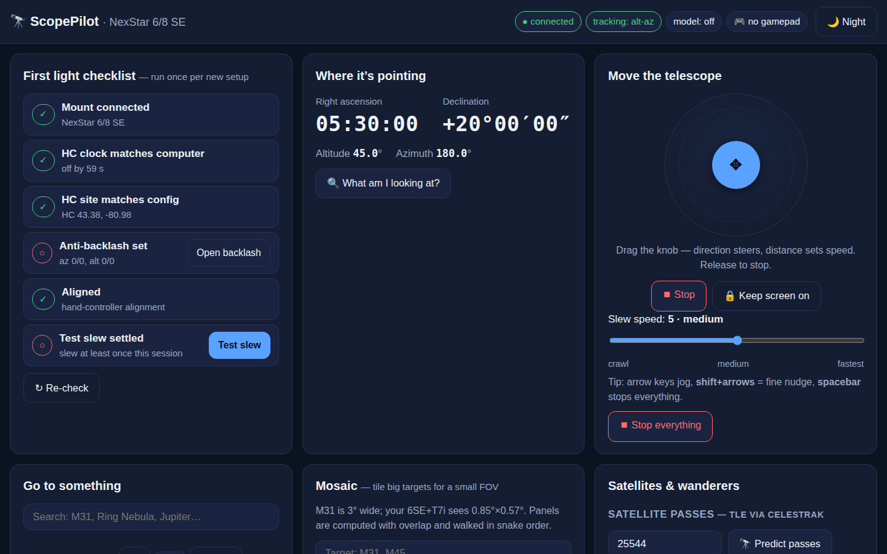
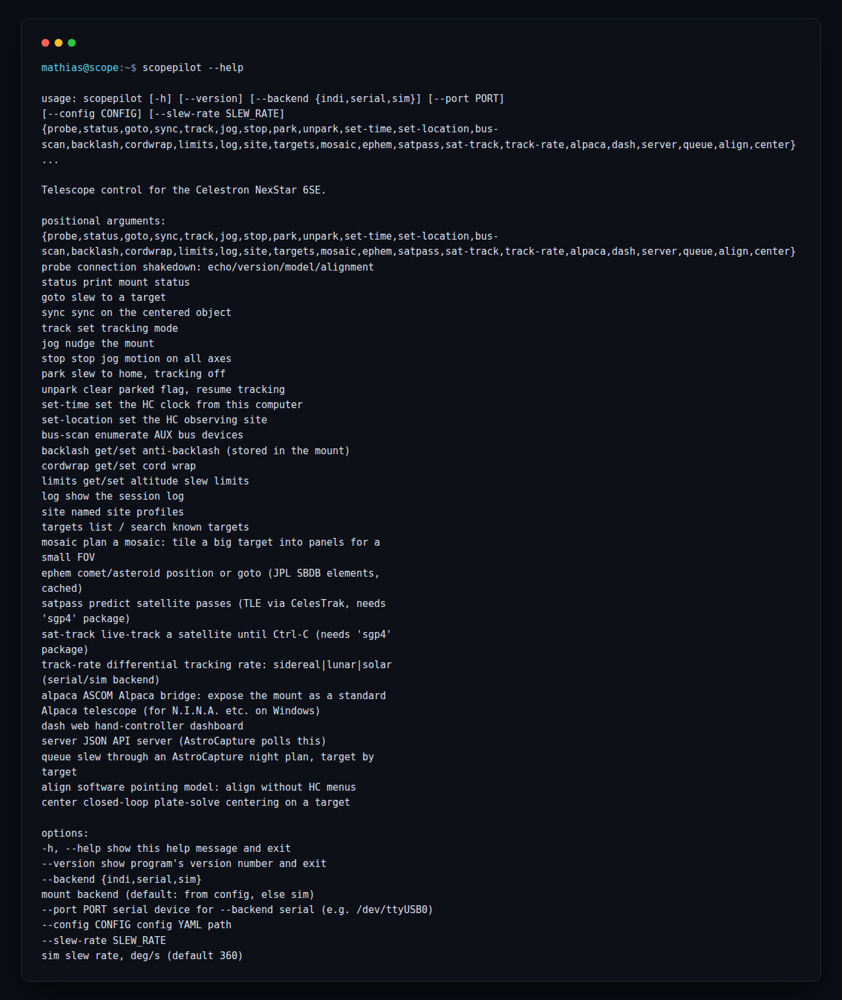
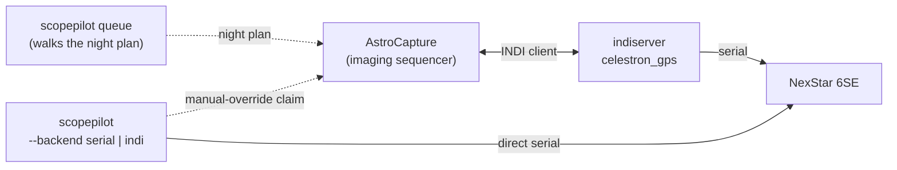

[](pyproject.toml)
[](pyproject.toml)
[](tests/)
[](LICENSE)

**Precision console for the Celestron NexStar 6SE — slew, sync, centre, repeat.**

Telescope control for the **Celestron NexStar 6SE**. ScopePilot is the
operator's console that sits next to
[AstroCapture](https://github.com/Skeleten80/astro-capture): AstroCapture
is the *imaging sequencer* (camera, exposure plan, plate solving,
guiding, stacking); ScopePilot is the *mount console* (slewing, syncing,
jogging, tracking, parking, a web hand-controller) — plus the glue that
lets the two programs share one mount without fighting over it.

## Screenshots





## Features

- **Real NexStar protocol driver** (`scopepilot/nexstar.py`) — pure
  Python, no compiled dependencies. HC serial commands (goto / sync /
  position / tracking / time / site) plus AUX-bus pass-through (fixed and
  variable rate slew, per-axis slew polling, bus scan, GPS check).
- **Software pointing model** — align with sync stars from your laptop;
  no hand-controller menus, no HC alignment (`scopepilot align`).
- **Closed-loop plate-solve centring** — slew, solve with AstroCapture's
  solver, auto-correct, repeat until the target is centred to ~1 arcmin
  (`scopepilot center`).
- **Three backends** — direct serial, INDI second-client, and a
  wire-level fake-6SE simulator that exercises the real driver code.
- **Web hand-controller** (`scopepilot dash`) — live position,
  press-and-hold jog pad, catalog GoTo with search, tracking modes, park,
  sync, pointing-model panel, and a manual-override claim AstroCapture
  can poll. Big readable panels, red night mode, phone/tablet friendly.
- **Night-queue bridge** (`scopepilot queue --plan …`) — reads an
  AstroCapture night plan and slews through its targets one by one, with
  optional drift-correcting re-centring.
- **Mosaic planner, comet/asteroid ephemerides, satellite tracking**
  (TLE + SGP4), lunar/solar tracking rates, moon-aware target ranking,
  ASCOM Alpaca bridge for N.I.N.A./SharpCap on Windows, and a gamepad
  mode for glove-friendly winter observing.
- 217 pytest tests, all passing on the simulator.

## Quick start (simulator, no hardware)

```bash
pip install -e .                 # PyYAML only; add pyserial for real serial
scopepilot probe                 # shakedown: echo/version/model/alignment
scopepilot goto "M51"            # slew the sim, wait for settle
scopepilot status --watch        # live position
scopepilot dash                  # web console on http://127.0.0.1:8765
```

## Real hardware

```bash
scopepilot --backend serial --port /dev/ttyUSB0 probe
```

`probe` is the shakedown: echo round-trip, HC firmware, model check
(expect **12 = 6/8 SE**), alignment state, tracking mode, AUX bus scan,
HC clock and site. If `probe` passes, the driver is talking to your mount.

The 6SE's hand controller has a PC port on its underside:
**post-2016 NexStar+ HC** → mini-USB (shows up as `/dev/ttyUSB0` on
Linux); **older HC** → RJ11 port, needs Celestron's RS-232 cable plus a
USB-serial adapter. Either way: **9600 baud, 8N1**. The hand controller
stays fully usable while ScopePilot is connected.

Typical session:

```bash
scopepilot --backend serial --port /dev/ttyUSB0 set-time
scopepilot --backend serial --port /dev/ttyUSB0 set-location --lat 43.3767 --lon -80.9809
scopepilot --backend serial --port /dev/ttyUSB0 goto "M13"
scopepilot --backend serial --port /dev/ttyUSB0 jog up --seconds 2
scopepilot --backend serial --port /dev/ttyUSB0 park
```

Config (`~/.scopepilot/config.yaml`, see `examples/scopepilot.yaml`)
remembers the backend, port, site, and park position so you can drop the
flags.

## Architecture



### Backends

| Backend  | How it talks to the mount | When to use it |
|----------|---------------------------|----------------|
| `serial` | Direct to the hand controller over the PC port | AstroCapture idle; full AUX-bus access (backlash, cord wrap) |
| `indi`   | Second INDI client on AstroCapture's indiserver | While imaging — no serial-port fight |
| `sim`    | Wire-level fake 6SE exercising the real driver | Development, testing, learning the CLI |

**Working alongside AstroCapture:** while imaging, let `indi_celestron_gps`
own the serial port and attach both programs as INDI clients
(`scopepilot --backend indi goto "M51"`). For unattended nights, let
AstroCapture plan and ScopePilot drive the slews:
`scopepilot queue --plan night_queue.yaml --dwell 30`. Grab the mount in
the dashboard (Claim button) and AstroCapture's sequencer can poll before
slewing — see `scopepilot/bridge.py`.

## Pointing model & centring

The HC stays plugged in as a dumb motor driver, but you never touch its
menus: ScopePilot drives the mount in alt-az and carries its own pointing
model.

```bash
scopepilot align                  # guided: slew to suggested stars, centre them, press Enter
scopepilot align --star Vega      # or one star at a time
scopepilot align --status         # offsets + RMS residual
scopepilot center "M51"           # slew -> capture -> solve -> correct -> repeat
```

Each sync star pairs the star's *true* alt-az (computed from site + time,
J2000 precessed to date) with the mount's *reported* alt-az. The model
saves to `~/.scopepilot/pointing.json` and auto-loads on every command.

**Power-on pose:** the model's zero points depend on where the OTA was
pointing at power-on. Always power on with the tube **level and pointing
north** and the saved model stays valid between sessions
(`scopepilot align --reuse` picks it up).

## Dashboard

```bash
scopepilot dash                  # http://127.0.0.1:8765
scopepilot dash --host 0.0.0.0   # expose to your phone/tablet on the LAN
```

Everything the hand controller does, in plain language: large RA/Dec +
Alt/Az readouts with slew indicator, a virtual joystick (drag the knob,
release to stop), catalog search with auto-centre, Tonight's best ranked
list, guided alignment wizard, tracking modes, park, HC info and clock
sync, anti-backlash sliders, slew limits, spiral search, per-star
residuals, adaptive pointing refinement, Sky Tour, site profiles, mosaic
planner, and satellite tracking. A 🌙 Night button switches the whole
page to deep red for dark adaptation. Add it to your phone's home screen
for a full-screen wireless hand controller (the computer at the scope
stays in charge — the phone is purely a remote).

## Honest caveats

- **Not yet tested against a physical 6SE.** The protocol follows
  Celestron's published spec cross-checked with a 2026-validated
  community reference, and every byte is exercised against the simulator
  — but the first real connection is a shakedown. Run `probe` first.
- **The pointing model is only valid if the scope is always powered on
  level and pointing north.** Change the power-on pose and the zero
  points are wrong; re-run `align`.
- **"Park" is a controlled slew**, not a true park — NexStar mounts have
  no park command or home sensor. It slews to your configured home
  (default az 0° / alt 5°) and switches tracking off.
- Slew limits guard gotos, not the jog pad. Slew-rate table (rates 1–9
  → °/s) is approximate; Celestron publishes only the ~4°/s SE maximum.
- Every slew, sync, centring, park, tracking change, and calibration is
  appended to `~/.scopepilot/sessions/YYYY-MM-DD.jsonl` (`scopepilot log`
  reads it back).

## Layout

```
scopepilot/
  nexstar.py     # protocol codecs + NexStarDriver (no third-party deps)
  sim.py         # wire-level fake 6SE hand controller (tests, sim backend)
  astro.py       # pure-python RA/Dec <-> alt-az (precession, <30" vs astropy)
  pointing.py    # software pointing model: sync stars, fit, persist
  center.py      # closed-loop plate-solve centring engine
  backends.py    # serial / sim / indi backends behind one interface
  controller.py  # orchestration: goto-and-wait, park, probe, alignment guard
  bridge.py      # AstroCapture glue: catalog, night plans, override polling
  server.py      # web console + JSON API (stdlib http.server)
  dash.html      # dashboard page (no CDN, works offline at the scope)
  config.py      # YAML config
  cli.py         # `scopepilot` command tree
tests/           # 217 tests: codecs, wire protocol vs sim, astro transforms,
                 # pointing model, closed loop, controller, bridge, HTTP API, CLI
```

## Related projects

- [AstroCapture](https://github.com/Skeleten80/astro-capture) — the
  imaging sequencer ScopePilot drives the mount for (camera control,
  exposure plans, plate solving, guiding, stacking).
- [AstroTonight](https://github.com/Skeleten80/astro-tonight) — "what's
  worth imaging tonight" companion app; exports night plans that
  `scopepilot queue` can walk.

## License

MIT — see [LICENSE](LICENSE).
